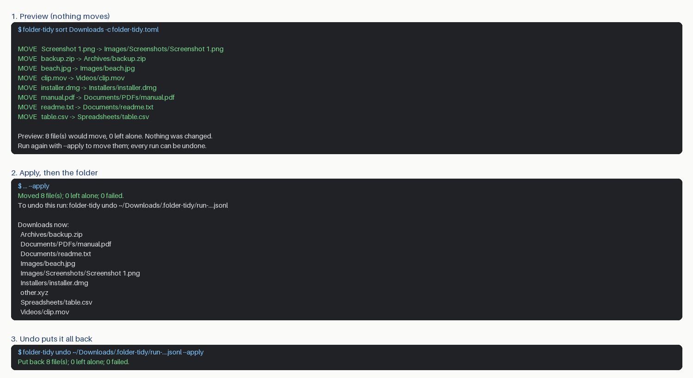

# folder-tidy

Sort a messy folder (Downloads, Desktop, a camera dump) by rules **you** write in a small text file.
It always shows you the plan first, it never replaces a file, and every run can be undone.



- **Preview first.** `sort` only prints what it would do. Nothing moves until you add `--apply`.
- **Never replaces anything.** If the destination name is taken, the file is skipped (or numbered, if you ask).
  Names that differ only in letter case count as the same name, as they do on macOS and Windows.
- **Undo any run.** Every move is written to a journal *before* it happens. `folder-tidy undo` puts the files back
  and removes the folders the run created. Files you changed since are left where they are.
- **Stays inside the folder.** Destinations must be folders inside the one you're sorting, and symbolic links are
  never followed. Hidden files and system files (`.DS_Store`, `Thumbs.db`) are left alone.
- **Won't break things.** It refuses to sort a disk's top folder, your home folder itself, or a software project
  (unless you add `--force`), and in recursive mode it never goes inside apps, photo or music libraries, or
  program folders. A file that changes between the preview and `--apply` is left alone.
- **No dependencies.** Plain Python 3.11+; nothing is uploaded and nothing connects to the internet.

## Install

```bash
uv tool install git+https://github.com/hassanitani6/folder-tidy
# or: pipx install git+https://github.com/hassanitani6/folder-tidy
```

## Use it

```bash
folder-tidy init                                      # writes folder-tidy.toml, an example to edit
folder-tidy sort ~/Downloads -c folder-tidy.toml      # preview: nothing is touched
folder-tidy sort ~/Downloads -c folder-tidy.toml --apply
```

The last line ends with the exact undo command for that run (copy it as printed), for example:

```bash
folder-tidy undo ~/Downloads/.folder-tidy/run-20260108-101500.jsonl           # preview
folder-tidy undo ~/Downloads/.folder-tidy/run-20260108-101500.jsonl --apply   # put everything back
```

## Rules file

```toml
recursive = false        # true = also sort files inside sub-folders
on_conflict = "skip"     # if the name is taken: "skip" the file, or "number" it ("a (1).jpg")
include_hidden = false   # true = also move files whose names start with a dot

[[rules]]                # rules are checked top to bottom; the first match wins
to = "Images/Screenshots"
names = ["Screenshot*", "Screen Shot*"]   # * means "anything"; letter case is ignored

[[rules]]
to = "Images"
extensions = ["jpg", "jpeg", "png", "heic"]
```

A rule can match by `extensions`, by `names`, or both (then a file must match both). Files no rule matches stay
where they are. Mistakes in the rules file are all listed at once, and nothing runs until they're fixed.

## Good to know

- The journal lives in a hidden `.folder-tidy` folder inside the sorted folder. It records paths relative to that
  folder only. Delete it whenever you no longer need to undo.
- iCloud files that aren't downloaded (shown with a cloud icon) are reported and skipped; open them in Finder first.
- Names containing `:` or `\` are left alone, because they can't be recorded for undo safely on every system.
- On drives without hard links (some USB sticks and network shares), moves use check-then-rename, which can't
  rule out another program creating the same name at the same instant. `folder-tidy doctor` tells you which applies.
- Undo needs the files to be unchanged (same size and modification time) and their old names to be free.
  Anything else is left alone and listed, so you can sort it out by hand.

## Safety and privacy

folder-tidy only moves files inside the folder you name; it never deletes your files. Undo removes only the
folders that run created, and only once they're empty apart from the hidden `.DS_Store` file macOS adds.
It makes no network connections.
`folder-tidy doctor` prints versions and two file-system checks, with your user name and home folder hidden, for
bug reports.

## Licence

MIT. See [LICENSE](LICENSE).
